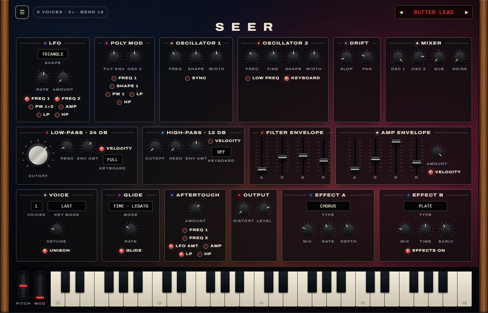

# Seer

An analog-modeled polyphonic synthesizer in the style of the Sequential Prophet-6: two
oscillators with continuous shapes, a sub and noise, a 4-pole low-pass and a 2-pole high-pass
filter, Poly Mod, six voices with unison. A Standalone app and a VST3, built with C++20 and JUCE 8.
"Seer" is a working name.



*The panel as designed: [docs/mockup/panel.html](docs/mockup/panel.html) is the interactive draft.
The app's window is a plain parameter list until milestone 3, when this panel is built and the
picture is replaced by a screenshot of the real window.*

## Status

| Milestone | What | State |
|---|---|---|
| M0 | Research, sound and UI design, panel mockup | done |
| M1 | Playable core: oscillators with sync, mixer, both filters, envelopes, LFO, 6 voices, wheels, pedal | done |
| M2 | Full voice: Poly Mod, aftertouch, unison, glide, slop, 4× mode; calibration; first presets | next |
| M3 | The panel window, presets, key strip with wheels | |
| M4 | Distortion and the two effects | |
| M5 | All factory presets (leads, basses and more), user guide, validation | |

## Docs

- [Sound design](docs/sound-design.md): the signal path, every parameter with its ID and range,
  and how each part is modeled
- [UI design](docs/ui-design.md): the window, the controls, the colours

## Build and run (Windows)

Requirements: Visual Studio 2026 (C++ workload), CMake ≥ 3.25, and JUCE 8.0.12 checked out at
`../JUCE` (otherwise it's downloaded automatically).

```powershell
cmake --preset vs2026
cmake --build --preset release
ctest --preset release
build\vs2026\Seer_artefacts\Release\Standalone\Seer.exe
```

The Standalone app switches on every connected MIDI keyboard by itself. Its status line shows
the inputs it found, a MIDI light, and what the pitch wheel, mod wheel and aftertouch send.

## Development

| Task | Command |
|---|---|
| Unit tests | `ctest --preset release`, or `build\vs2026\Release\SeerTests.exe "[osc]"` (`[filter]`, `[env]`, `[engine]`) |
| Time the engine | `build\vs2026\Release\SeerTests.exe "[.bench]"` |
| Hear the engine without a host | `build\vs2026\SeerRender_artefacts\Release\SeerRender.exe build\renders`: twelve test phrases as WAVs, with their levels |
| Validate the VST3 | `powershell -ExecutionPolicy Bypass -File scripts\run-pluginval.ps1` |
| Use the VST3 in Live | `scripts\install-dev-link.ps1` from an elevated PowerShell, then rescan plug-ins |

```
source/engine   oscillators, filters, envelopes, voices, the engine (no GUI; unit-tested)
source          processor, editor, parameters
tests           Catch2 tests and the render tool
docs            sound and UI design, the panel mockup, screenshots
```

## Credits

Not affiliated with or endorsed by Sequential. Fonts: Archivo (SIL OFL). JUCE is dual-licensed
(AGPLv3 or commercial): check its terms before distributing binaries.
