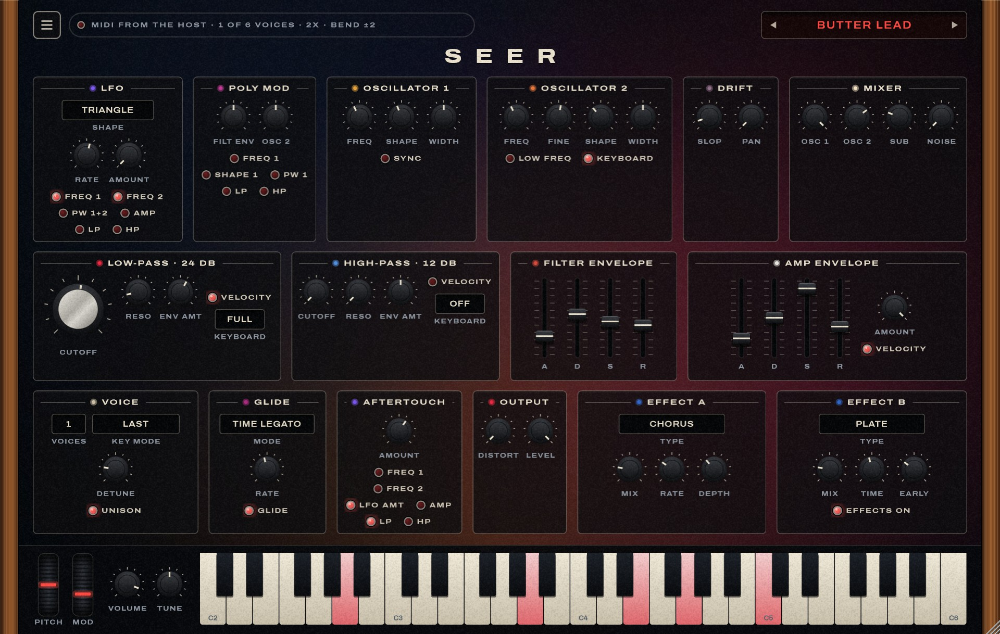
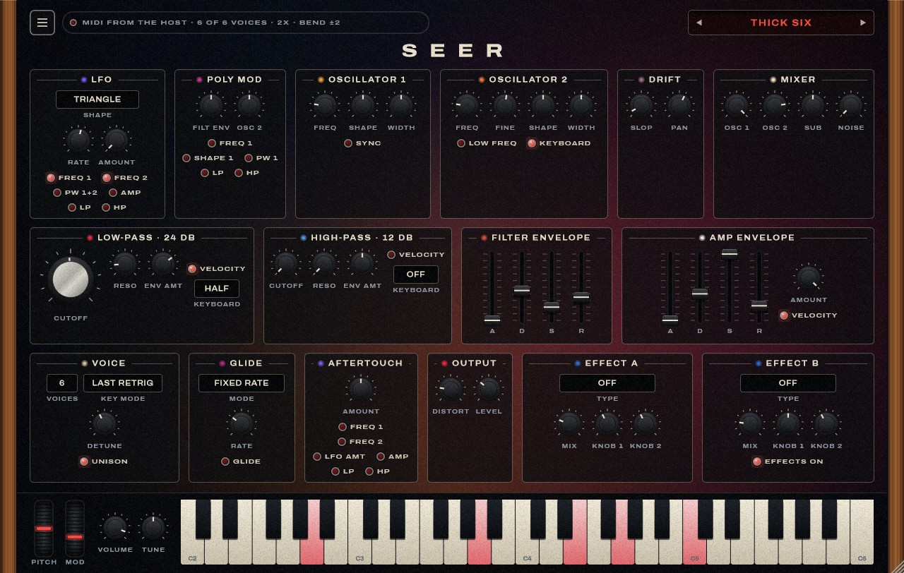
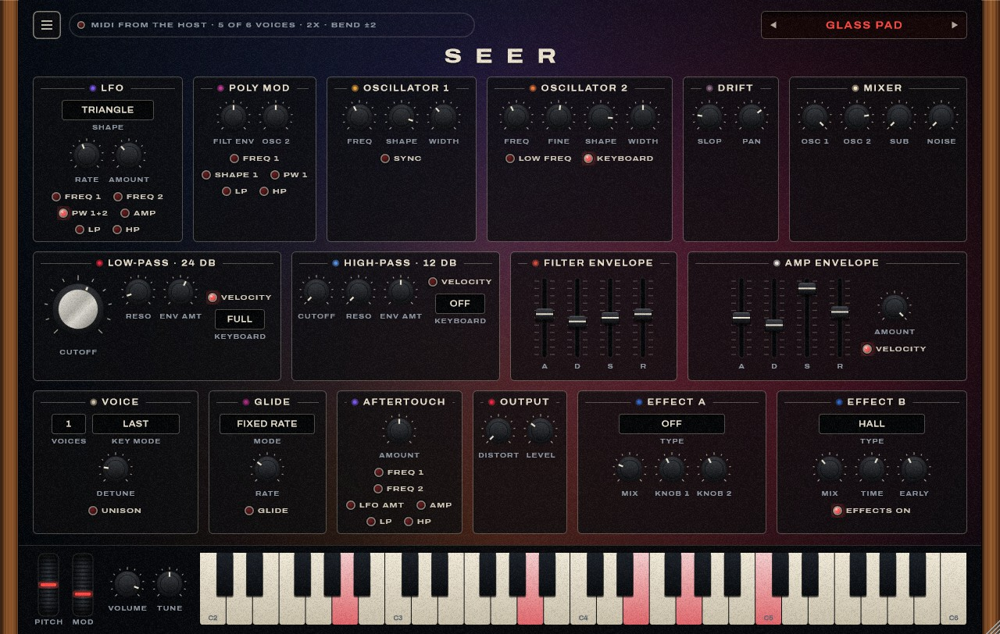

# Seer

An analog-modeled polyphonic synthesizer in the style of the Sequential Prophet-6: two
oscillators with continuous shapes, a sub and noise, a 4-pole low-pass and a 2-pole high-pass
filter, Poly Mod, six voices with unison, distortion and two effects. A Standalone app and a VST3,
built with C++20 and JUCE 8. "Seer" is a working name.



It comes with 25 presets: eight mono leads for smooth, legato lines, eight basses, and pads and
keys. See the [user guide](docs/user-guide.md).

| | |
|---|---|
|  |  |
| **Thick Six**: six detuned voices on one note, with sub and distortion | **Glass Pad**: pulse-width modulation, slow envelopes, hall |

## Status

Everything on the panel works. The model is built from the instrument's manual and from
established analog-circuit models, and checked by measurement (tuning, filter slopes, aliasing,
envelope times). It has not been compared against a real Prophet-6, so how close it sounds is
still to be judged by ear.

Not built: the sequencer, the arpeggiator, chord memory, clock sync for the LFO and delays.

## Docs

- [User guide](docs/user-guide.md): getting sound, the presets, every control, recipes
- [Sound design](docs/sound-design.md): the signal path, every parameter with its ID and range,
  how each part is modeled, and what was measured
- [UI design](docs/ui-design.md): the window, the controls, the colours, and the interactive
  first draft in [docs/mockup](docs/mockup)

## Build and run (Windows)

Requirements: Visual Studio 2026 (C++ workload), CMake ≥ 3.25, and JUCE 8.0.12 checked out at
`../JUCE` (otherwise it's downloaded automatically).

```powershell
cmake --preset vs2026
cmake --build --preset release
ctest --preset release
build\vs2026\Seer_artefacts\Release\Standalone\Seer.exe
```

The Standalone app switches on every connected MIDI keyboard by itself. The status line at the
top left names the inputs, and its lamp blinks when MIDI arrives.

## Development

| Task | Command |
|---|---|
| Unit tests | `ctest --preset release`, or `build\vs2026\Release\SeerTests.exe "[osc]"` (`[filter]`, `[env]`, `[engine]`, `[voice]`, `[fx]`, `[preset]`) |
| Time the engine | `build\vs2026\Release\SeerTests.exe "[.bench]"` |
| Hear every preset without a host | `build\vs2026\SeerRender_artefacts\Release\SeerRender.exe build\renders`: a phrase through each preset as WAVs, with their levels |
| Screenshot the window | `build\vs2026\SeerUiSnapshot_artefacts\Release\SeerUiSnapshot.exe ui.png --demo [--preset 8] [--scale 1.5] [--set lpCutoff=90]` (write `.jpg` for the docs) |
| Validate the VST3 | `powershell -ExecutionPolicy Bypass -File scripts\run-pluginval.ps1 -Strictness 10` |
| Use the VST3 in Live | `scripts\install-dev-link.ps1` from an elevated PowerShell, then rescan plug-ins |

```
source/engine   oscillators, filters, envelopes, voices, effects, the engine (no GUI; unit-tested)
source/ui       look and feel, panels and controls, wheels, keys, the light behind the panels
source          processor, editor, parameters, presets
tests           Catch2 tests, the render tool and the screenshot tool
docs            guides, design, the mockup, screenshots
assets          fonts (OFL)
```

## Credits

Not affiliated with or endorsed by Sequential. The reverb comes from Keys. Fonts: Archivo
(SIL OFL, see `assets/fonts/OFL.txt`). JUCE is dual-licensed (AGPLv3 or commercial): check its
terms before distributing binaries.
