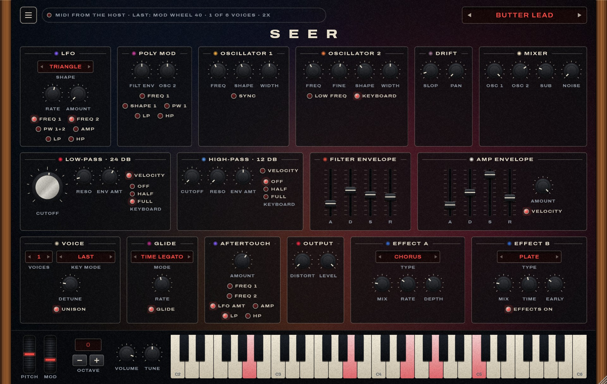

# Seer · UI design

The window carries the synth's full panel on one screen, dressed as analog hardware: wooden end
cheeks, near-black panels with cream silkscreen frames and lettering, physical knobs, red LEDs,
and a grain over everything. The field of light from Keys' Nocturne look still moves behind the
panels, dimmer.



The first draft, for comparison: [images/seer-panel-draft.png](images/seer-panel-draft.png).

- Interactive draft: [`mockup/panel.html`](mockup/panel.html), published privately at
  https://claude.ai/artifact/X6Bv36bAcJHL1hLWBSCnFA
- Every control and its parameter ID: [sound-design.md](sound-design.md)

Teletone Audio's instruments set the mood (few colours, reactive artwork, evocative lettering).
The artwork, names and layout are our own, and the hardware's panel graphics are not copied.

## Window

Design size 1280 × 812, key strip included; scaled as a whole from 70 % to 200 %, by dragging the
window's corner or from ☰ → Window size. The first time it opens as large as fits the screen
comfortably, up to 125 %. The size is kept in `%APPDATA%/Seer/Seer Preferences.settings`, shared by
every instance (not in the song).

```
header   ☰ menu · status chip (MIDI lamp, inputs, last message, voices, quality) · ◀ preset ▶
title    S E E R
row 1    LFO · Poly Mod · Oscillator 1 · Oscillator 2 · Drift (slop, pan) · Mixer
row 2    Low-pass (large cutoff knob) · High-pass · Filter envelope · Amp envelope
row 3    Voice (unison) · Glide · Aftertouch · Output (distortion, level) · Effect A · Effect B
keys     pitch wheel · mod wheel · octave − readout + · master volume · master tune · 49 keys, C2–C6
```

The rows follow the signal: sources, then filters and envelopes, then how it plays and where it
goes.

## Controls

| Control | Looks like | Used for |
|---|---|---|
| Knob, 42 px | dark skirt and cap with a drop shadow, one cream pointer line, an 11-mark printed scale | most parameters |
| Large knob, 88 px | the same with a brushed-silver cap | low-pass cutoff only |
| Fader | recessed slot with a printed scale, a dark cap with a cream line | the two ADSRs |
| LED | red lamp in a chrome bezel, lit when on | switches and modulation destinations |
| Display selector | recessed display window, the choice in red lit capitals, small ◀ ▶ inside; click the name for the list | LFO shape, voices, key mode, glide mode, effect types |
| Lamp selector | a column of LEDs with their names | the filters' keyboard tracking (Off, Half, Full) |
| Preset display | red LED-style readout between ◀ ▶ | preset name; click it for the browser |
| Octave buttons | two small dark keys around a red readout | transposition; right-click to learn a keyboard's button |

Interaction is the same as in Keys: drag up or down, Shift for fine steps, double-click to reset,
scroll wheel, arrow keys. A control's caption turns into its value while the mouse is over it; the printed scales don't
light up, so that readout and the pointer are how a value is read.
A panel's frame takes its section's colour while one of its controls moves.
Display selectors sit above the knobs in their panel, so each row fits on one line. Menus (the
selectors' lists, ☰) use the same look: a lamp marks the chosen item, headings in small capitals.

## Section colours and the light field

| Section | Hue | In the field |
|---|---|---|
| Oscillators, mixer | amber `#e8a33d`, orange `#e8763a`, cream `#f4e3c3` | warm light, brighter with the mixer levels |
| Low-pass | red `#e8263f` | brighter as the cutoff opens |
| High-pass, effects | blue `#4f8fe0`, `#2f66c8` | blue haze |
| LFO, aftertouch | violet `#7a56ec` | violet light; the field moves faster with LFO amount and slop |
| Poly Mod, glide | magenta `#c23a94`, `#b02a84` | grows with resonance and distortion |
| Notes | cream | a glow at the key's position that fades with the note |

## Menu (☰)

Window size; voice count (6, 8, 10, 12); quality (2× or 4× oversampling); Your keyboard: pitch-wheel
range, mod-wheel depth, transpose, learning the octave buttons; Presets; Save preset. Master volume
and tune are the two knobs in the key strip.

## Header

The status line shows a MIDI lamp, the MIDI inputs (Standalone), the last message received, how
many voices are sounding, and the quality. The preset readout steps with its arrows; clicking the
name opens the preset browser.

## Preset browser

A panel that opens under the readout, over a dimmed window (a click outside closes it). Left: the
factory groups (All, Leads, Basses, Pads, Keys) and the user's banks, one per folder in
`Documents/Seer/Presets`. Right: the group's presets in three columns; the current one has a lamp.
Clicking a preset loads it and leaves the browser open. Footer: New bank, Save current sound (name
and bank), Open folder. Right-click a user preset to delete it.

## How it is built

| Part | Class | File |
|---|---|---|
| Colours, fonts, knob / fader / LED / menu drawing | `SeerLookAndFeel` | `source/ui/SeerLookAndFeel.*` |
| A section plate that lays out its own controls | `Panel` | `source/ui/Controls.*` |
| Knob, fader, switch, selectors | `KnobControl`, `FaderControl`, `LedToggle`, `ChoiceControl`, `LedSelector` | `source/ui/Controls.*` |
| Octave buttons | `OctaveControl` (and `OctaveButtons` in the engine for the learned MIDI) | `source/ui/Controls.*` |
| Preset browser | `PresetBrowser` | `source/ui/PresetBrowser.*` |
| Preset readout, status line, wheels, keys | `PresetDisplay`, `StatusChip`, `WheelControl`, `SeerKeyboard` | `source/ui/Controls.*` |
| The light, the grain and the wood | `LightField`, `Overlay` | `source/ui/Controls.*` |
| The window: which control goes on which panel | `SeerEditor` | `source/PluginEditor.*` |

The light is painted into a 160 × 100 image 15 times a second and stretched over the window.
Panels and the grain are kept as images, so a frame of light costs a few copies. With the window
open and nothing playing, the Standalone app uses about 7 % of one core.
