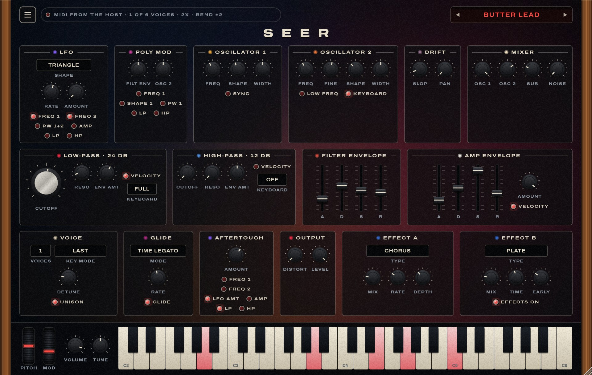

# Seer · user guide

## Getting sound

**Standalone app**: start `Seer.exe`. Every connected MIDI keyboard is switched on by itself; the
status line at the top left names them, and its lamp blinks when MIDI arrives. If there is no
sound, open Options (top left of the window frame) → Audio/MIDI Settings and pick your audio
output.

**In Ableton Live**: run `scripts\install-dev-link.ps1` once from an elevated PowerShell, rescan
plug-ins, and drop Seer on a MIDI track.

Without a MIDI keyboard: click the on-screen keys (lower on a key is louder). Click them once and
the computer keyboard plays too: `A W S E D F T G Y H U J K` from C3.

## Presets

The red readout at the top right shows the current sound. The arrows step through the list;
clicking the name opens it.

| Leads | Character |
|---|---|
| Butter Lead | the house lead: two soft sawtooths, a little sub, chorus and plate |
| Silk Thread | nearly a sine, with an octave on top; hall |
| Hollow Reed | two pulse waves, woody; tape-style echo |
| Sync Singer | hard sync swept by the filter envelope |
| Velvet Fifths | oscillator 2 a fifth up |
| Night Flute | a triangle with breath noise and a slow attack |
| Glass Whistle | no oscillators: the filter itself sings. Pressure bends it up |
| Wheel Cry | resonant and driven, with a spring reverb |

| Basses | Character |
|---|---|
| Thick Six | six voices stacked and detuned, with sub and some distortion |
| Sub Floor | triangle and sub: mostly fundamental |
| Round Wool | soft and round, a little pulse underneath |
| Rubber | a resonant filter snap on every note; glides when notes overlap |
| Reso Growl | high resonance into distortion |
| Pluck Low | polyphonic, short |
| Fretless | slides between overlapping notes; pressure adds vibrato |
| Wide Detune | two detuned voices, one on each side |

Then pads (Glass Pad, Slow Strings, Sweep Phase), keys (Brass Section, Poly Mod Bell, Clav Pulse,
Soft Keys, Gate Organ) and **Init**, a plain starting point.

**Playing the leads.** They are monophonic and legato: hold a note and play the next one to
glide into it; lift first for a clean new attack. The mod wheel brings in vibrato. Pressing into
a key after it is down (aftertouch) opens the filter and adds vibrato. The pitch wheel bends two
semitones unless you change it in the menu.

**Saving your own.** ☰ → Save preset. It lands in `Documents/Seer/Presets` and appears under
"Yours". Presets store the sound; master volume, tune, the bend range, transpose, the voice count
and the quality stay as you set them.

## Every control

Drag a knob or fader up or down. Hold Shift for fine steps, double-click to reset, or use the
scroll wheel. The caption under a control shows its value while the mouse is over it. A red lamp
is a switch.

### Row 1: the tone

| Panel | Control | What it does |
|---|---|---|
| LFO | Shape, Rate, Amount | A slow wave that moves whatever its lamps select. With Amount at 0 the mod wheel alone brings it in |
| | Freq 1, Freq 2, PW 1+2, Amp, LP, HP | Destinations: pitch of each oscillator (vibrato), pulse width, loudness (tremolo), the two filters |
| Poly Mod | Filt env, Osc 2 | Two more modulation sources, each from −100 to +100: the filter envelope, and oscillator 2 itself, at audio rate |
| | Freq 1, Shape 1, PW 1, LP, HP | Destinations. Osc 2 → Freq 1 is FM: bells and metal. Filt env → Freq 1 with Sync on is the classic sync sweep |
| Oscillator 1 | Freq, Shape, Width | Pitch in semitones; triangle → sawtooth → pulse, continuously; the pulse's width |
| | Sync | Oscillator 1 restarts with every cycle of oscillator 2 |
| Oscillator 2 | Freq, Fine, Shape, Width | The same, plus fine tuning of ±50 cents: a few cents against oscillator 1 fattens the sound |
| | Low freq, Keyboard | Makes it an LFO for Poly Mod; lets it ignore the keys |
| Drift | Slop, Pan | Random tuning drift, from none to badly out of tune; how far the voices spread left and right |
| Mixer | Osc 1, Osc 2, Sub, Noise | Levels. Sub is a triangle an octave under oscillator 1. High levels push the filter into saturation |

### Row 2: the shape

| Panel | Control | What it does |
|---|---|---|
| Low-pass | Cutoff, Reso | Removes highs above the cutoff, 24 dB per octave. Resonance emphasises the cutoff; near full it whistles by itself |
| | Env amt, Velocity, Keyboard | How far the filter envelope opens (or, negative, closes) it; whether playing harder opens it more; whether higher notes are brighter (Full: the whistle plays in tune) |
| High-pass | the same five | Removes lows below the cutoff, 12 dB per octave. Both filters together leave a band |
| Filter envelope | A D S R | The filter's movement over a note: attack time, decay time, sustain level, release time |
| Amp envelope | A D S R, Amount, Velocity | The same for loudness. With Velocity on, harder is louder |

### Row 3: playing and output

| Panel | Control | What it does |
|---|---|---|
| Voice | Unison, Voices, Detune, Key mode | Unison: one note at a time, on 1 to 6 stacked voices, detuned against each other. Key mode: which of several held keys sounds (lowest, highest, last), and whether each new note restarts the envelopes (Retrig) |
| Glide | Glide, Rate, Mode | Slides between notes. Fixed rate: bigger jumps take longer. Fixed time: every jump takes the same. Legato: only when notes overlap |
| Aftertouch | Amount, six lamps | What key pressure does: bend either oscillator, add LFO, change loudness, move the filters |
| Output | Distort, Level | Distortion after the voices; the preset's volume |
| Effect A, Effect B | Type, Mix, two knobs | Two effects in a row. The knobs are Time and Feedback for the delays, Rate and Depth for chorus and phasers, Time and Early for the reverbs, Decay and Tone for the spring. Reverbs are in B only |

### The bottom strip

Pitch wheel (springs back), mod wheel, master Volume and Tune, and 49 keys from C2 to C6. The
wheels follow your keyboard's wheels.

### The ☰ menu

Voices (6 like the original, up to 12), Quality (4× oversampling is cleaner in the highest octaves
and costs about twice the CPU), Pitch wheel range, Transpose, Save preset, Open the preset folder.

## Recipes

- **A lead that glides only when you want it**: Unison on, Voices 1, Key mode Last, Glide on,
  Mode Time Legato, Rate around 40.
- **A thicker bass**: Unison on, Voices 4 to 6, Detune 30 to 50, Pan up, Sub up, and bring Level
  down.
- **Vibrato on the wheel only**: LFO Amount 0, Shape Triangle, lamps Freq 1 and Freq 2 on.
- **A filter that follows your touch**: Low-pass Velocity on, Env amt around +30; in Aftertouch,
  Amount +25 and the LP lamp.
- **A bell**: both oscillators on triangle, Osc 2 Freq well above Osc 1, Mixer Osc 2 at 0, Poly
  Mod Osc 2 around +40 with the Freq 1 lamp.
